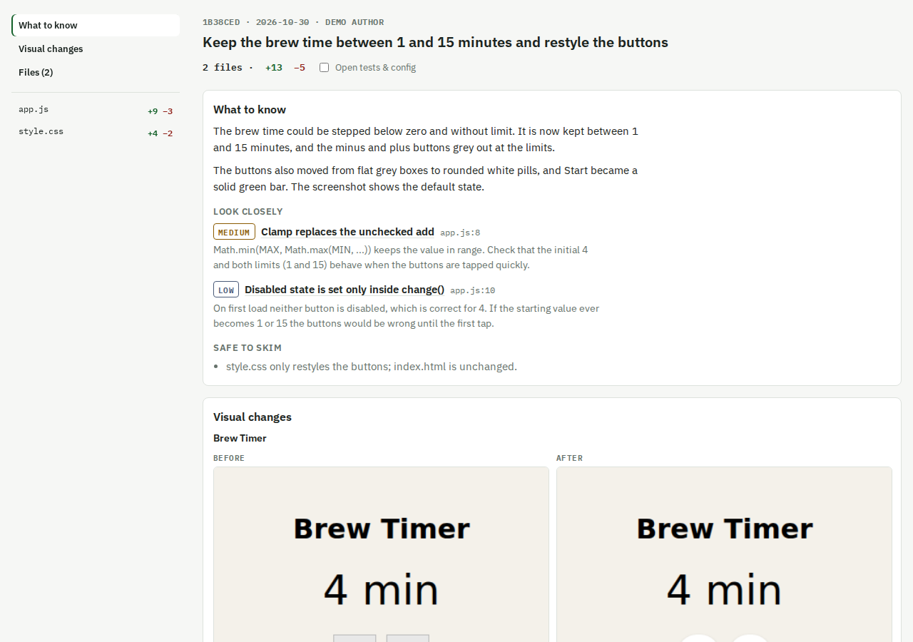
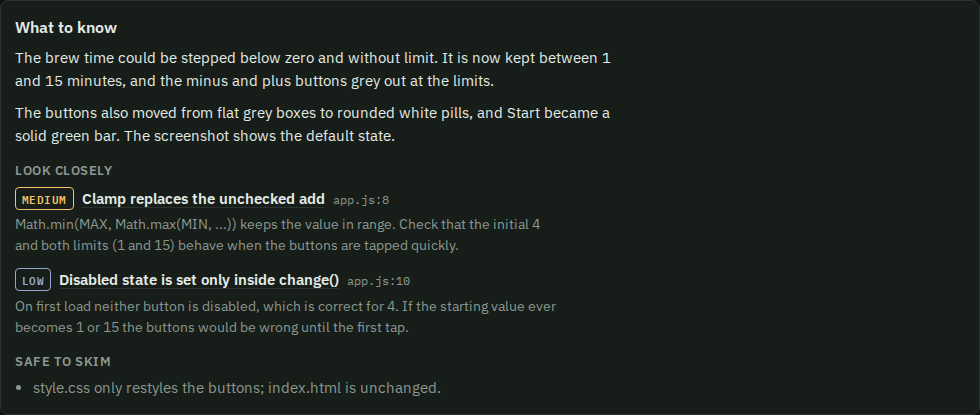
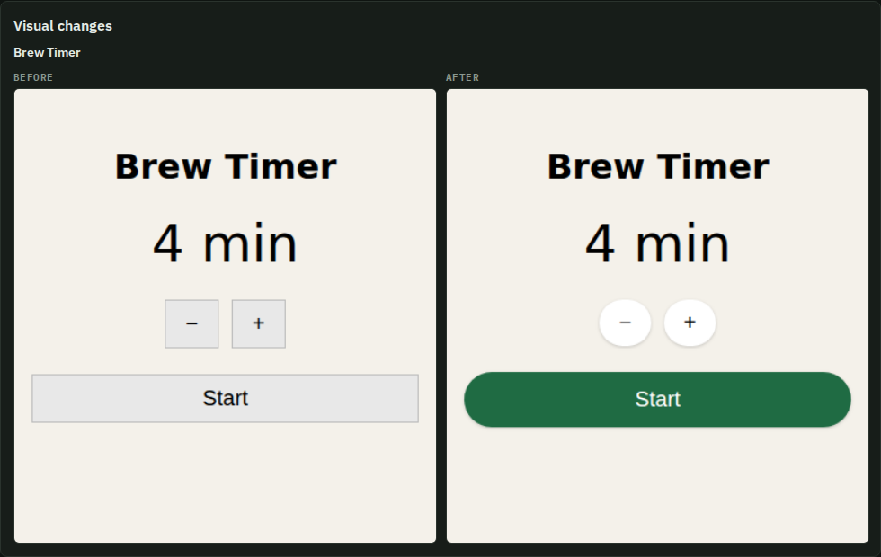
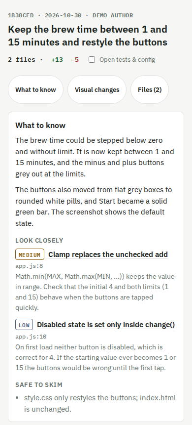
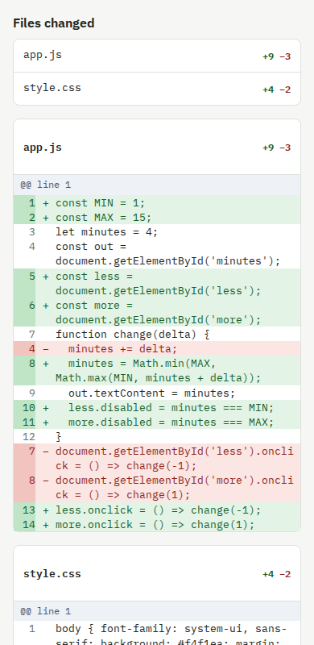
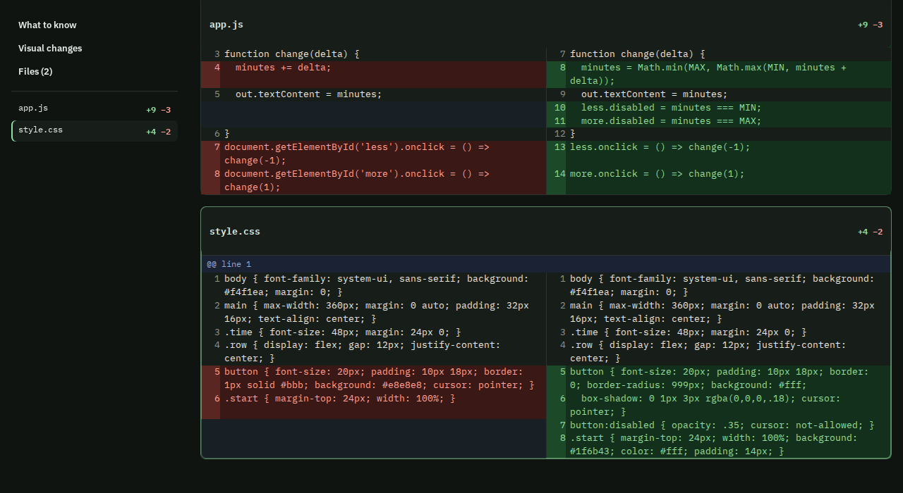

# diff-review

[](LICENSE)
[](#quickstart)

Review your agent's code changes on your phone or desktop. Claude tells you what changed and where to look, then lays the diff out so it's pleasant to read.



## A review page that tells you where to look

A 500-line diff in a terminal is hard to read, and on a phone it's worse. `diff-review` reads the change for you and builds one self-contained HTML page:

- **A guide to the change.** A short summary, a "look closely" list ranked by risk, and a "safe to skim" list.
- **Before/after screenshots** when the change affects how something looks.
- **A diff made for reading.** Wrapped lines on a phone, side by side on a wide screen, collapsible files.

Everything is generated from the real diff, in any git repo.

## Quickstart

### 1. Install

```
/plugin marketplace add sahariko/diff-review
/plugin install diff-review@diff-review
```

Without the plugin system, copy `skills/diff-review/` into `~/.claude/skills/`.

### 2. Optional: turn on screenshots

You need Node 18+ and Playwright. If the repo doesn't have them, the skill asks before downloading Chromium (about 150 MB). Without them you still get the guide and the diff. See [UI screenshots](docs/ui-screenshots.md).

### 3. Run it

```
/diff-review
```

Claude reads the diff of your whole branch, writes the review notes, takes screenshots if the UI changed, builds the page and opens it.

## Usage

```
/diff-review                              # the whole branch, opened in your browser (switch to Committed or Uncommitted on the page)
/diff-review the last commit              # just HEAD
/diff-review the last 3 commits           # any commit range
/diff-review on my phone                  # publish a private page and open the link
/diff-review local                        # keep it on this machine
```

If it isn't clear where you'll read it, it opens the page locally and offers a phone link. It never publishes unless you ask for a phone view, a link or sharing.

## Features

### A guide to the change

Claude writes a short summary and a ranked "look closely" list from the code, including callers and validation outside the diff when a risk depends on them. Each item jumps to the exact line and highlights it.



### Before/after screenshots

When the diff touches visible UI, the skill captures the before from the base commit and the after from your working tree, using Storybook if the repo has it or a dev server if not. It skips screenshots rather than showing placeholders. On a phone you flip between Before and After; on a wide screen they sit side by side.



### Built for small screens

One column, wrapped lines, a row of jump links under the title and a back-to-top button. Light and dark themes follow your phone.

| The guide | The diff |
|---|---|
|  |  |

### Built for big screens

Side-by-side diffs and a sticky contents sidebar that lists every section and file and highlights the one you're reading.



### Local and remote

| | Local | Remote |
|---|---|---|
| For | Reviewing at your computer | Reviewing on your phone, or sharing a link |
| What happens | Writes `~/.cache/diff-review/<repo>-<range>.html` and opens it in your browser | Publishes the same page as a private Artifact and opens the link |
| Your code | Stays on your machine | Is uploaded to a private page on claude.ai; only you can open it until you share it |

A phone can't open a local file, so for the phone use remote. Remote needs a Claude Code setup with the Artifact tool.

Want to see a real page? Open [`examples/brew-timer-review.html`](examples/brew-timer-review.html) in a browser.

## License

[MIT](LICENSE)
